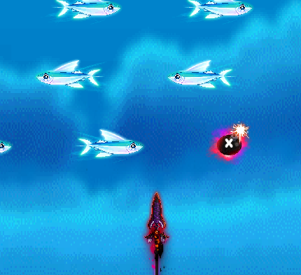
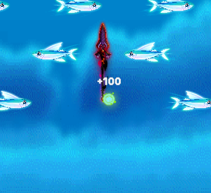

# 미니게임

[프로젝트](../README.md) / [전체 코드](CodeIndex.md)

## 공통 실행과 게임별 확장

게임마다 조작과 보상은 달랐지만 시작, 종료, 플레이어 이탈 처리는 겹쳤습니다. 사용자 세션은 공통 API에서 관리하고 조작과 판정, 보상 규칙은 각 게임에 뒀습니다. 이 방식으로 달고나, 주사위, 낚시와 사다리를 추가했습니다.

[StartMiniGameEvent](../Source/RootDesk/MyDesk/Event/EventExecutor.mlua#L163)에서 게임 ID, 사용자 ID와 이벤트 ID를 넘겨 [공통 세션을 엽니다](../Source/RootDesk/MyDesk/MiniGame/Server/MiniGameContentService.mlua#L26). 게임이 끝나면 세션 ID와 이벤트 ID가 맞는지 확인하고 NPC 이벤트를 이어갑니다. 야시장은 로비 승인과 시작 조건도 확인합니다.

| 역할 | 코드 |
| --- | --- |
| 플레이어별 세션을 열고 닫기 | [MiniGameSessionService](../Source/RootDesk/MyDesk/MiniGame/Server/MiniGameSessionService.mlua#L231) |
| 게임에 맞는 서버 규칙 선택 | [MiniGameServerHandlerRegistry](../Source/RootDesk/MyDesk/MiniGame/Server/MiniGameServerHandlerRegistry.mlua#L6) |
| 게임에 맞는 클라이언트 처리 선택 | [MiniGameClientHandlerRegistry](../Source/RootDesk/MyDesk/MiniGame/Client/MiniGameClientHandlerRegistry.mlua) |
| 화면을 고르고 열고 닫기 | [MiniGameUIRouter](../Source/RootDesk/MyDesk/MiniGame/MiniGameUIRouter.mlua), [MiniGameViewRegistry](../Source/RootDesk/MyDesk/MiniGame/Client/MiniGameViewRegistry.mlua) |
| 게임 설정, 입력과 성공 조건 | [MiniGameTable](../Source/RootDesk/MyDesk/MiniGame/Data/MiniGameTable.mlua), [MiniGameRuleEngine](../Source/RootDesk/MyDesk/MiniGame/Rule/MiniGameRuleEngine.mlua) |

새 게임의 서버 규칙과 클라이언트 화면을 등록하면 공통 절차를 그대로 쓸 수 있습니다. PC 키보드와 모바일 터치는 같은 게임 행동으로 넘깁니다. 진행 상태와 화면 표시는 따로 관리합니다.

플레이어가 접속을 끊으면 서버가 세션을 정리합니다. 맵 이동 시 취소하도록 설정된 게임은 시작 맵을 벗어날 때도 정리합니다. 낚시 정산이 진행 중이거나, 기존 세션에 예약한 판돈이나 진행 중인 정산이 있으면 새 게임을 열지 않습니다. [세션 시작과 종료 코드](../Source/RootDesk/MyDesk/MiniGame/Server/MiniGameSessionService.mlua)

## RPC 요청자와 입력 검증

낚시 입력을 받으면 [RequestFishingInput](../Source/RootDesk/MyDesk/MiniGame/MiniGameManager.mlua#L5)에서 `senderUserId`로 해당 사용자의 세션을 찾습니다. 낚시 세션이 활성 상태인지 확인하고 [HandleInput](../Source/RootDesk/MyDesk/MiniGame/Server/MiniGameFishingServerHandler.mlua#L55)에서 입력 순번, 행동과 좌표 범위를 검사합니다.

시작 옵션과 실행 정보, 입력과 상태는 내부에서 Struct로 씁니다. RPC로 보낼 때 `ToPlainTable`로 바꾸고 받은 쪽에서 다시 Struct를 만듭니다. 서버가 요청자와 세션 소유자가 같은지, 전달받은 값이 범위 안에 있는지 확인합니다.

## 낚시의 입력과 화면 갱신

서버 상태가 도착할 때만 그리면 물고기 움직임이 수신 간격에 묶입니다. 조준 위치와 발사는 서버로 보내고 판정된 상태를 받았습니다. 화면에서는 마지막 상태와 받은 뒤 흐른 시간을 바탕으로 물고기 위치를 매 프레임 그리도록 했습니다.

- 조준 위치가 바뀌면 [Update](../Source/RootDesk/MyDesk/MiniGame/Client/MiniGameFishingModel.mlua#L114)에서 마지막 위치를 0.05초 간격으로 보냅니다. 발사나 시작 입력은 이동 전송을 기다리지 않고 [Send](../Source/RootDesk/MyDesk/MiniGame/Client/MiniGameFishingPresenter.mlua#L81)로 보냅니다.
- [ApplyState](../Source/RootDesk/MyDesk/MiniGame/Client/MiniGameFishingModel.mlua#L75)는 세션 ID와 갱신 번호를 비교해 다른 세션의 상태나 이미 처리한 상태를 거릅니다.
- [OnUpdate](../Source/RootDesk/MyDesk/MiniGame/Client/MiniGameFishingPresenter.mlua#L116)에서 입력을 처리한 뒤 화면을 갱신합니다. [UpdatePresentation](../Source/RootDesk/MyDesk/MiniGame/Client/MiniGameFishingStageView.mlua#L640)은 마지막 서버 진행 시간에 수신 후 경과 시간을 더합니다. 그 값과의 차이에 따라 화면 쪽 시간의 속도를 최대 10% 조절해 물고기 위치 차이를 서서히 보정합니다.

화면에 그리는 개체와 적중 효과는 풀에서 꺼내 다시 씁니다. [Reset](../Source/RootDesk/MyDesk/MiniGame/Client/MiniGameFishingVisual.mlua#L59)으로 이전 상태를 지우고 배치 갱신이 끝나면 화면에 띄웁니다.

이후 수정한 코드: [화면 갱신](../SourceUpdates/abbb12c/RootDesk/MyDesk/MiniGame/Client/MiniGameFishingStageView.mlua#L682), [입력 처리](../SourceUpdates/abbb12c/RootDesk/MyDesk/MiniGame/Client/MiniGameFishingPresenter.mlua#L119)

| 창으로 조준 | 발사 후 적중 |
| --- | --- |
|  |  |

## 입력 기록으로 결과 재계산

연타, 타이밍, 게이지와 도형 입력은 [MiniGameInputProof](../Source/RootDesk/MyDesk/MiniGame/Data/MiniGameInputProof.mlua)에 기록해 서버로 보냅니다. [ResolveClientResult](../Source/RootDesk/MyDesk/MiniGame/Server/MiniGameClientResultServerHandler.mlua#L63)가 시간 순서, 입력 개수와 좌표를 확인한 뒤 같은 규칙으로 성공 여부와 점수를 다시 계산합니다.

[HandleClientResult](../Source/RootDesk/MyDesk/MiniGame/Server/MiniGameSessionService.mlua#L496)에서 요청자와 세션 상태가 맞을 때 결과를 확정합니다. 낚시처럼 서버가 게임을 직접 진행하는 경우는 별도의 규칙으로 처리합니다.

## 출시 후 피드백에 따른 개선

출시 후 커맨드 미니게임 조작에 대한 피드백을 받았습니다. 시작 전에 필요한 리소스를 불러오고, 입력이 한꺼번에 와도 서버에서 아직 처리하지 않은 입력부터 반영하도록 고쳤습니다.

- [LoadingUILogic](../Source/RootDesk/MyDesk/UI/LoadingUILogic.mlua#L201)이 [MiniGameViewRegistry](../Source/RootDesk/MyDesk/MiniGame/Client/MiniGameViewRegistry.mlua#L53)에서 가져온 리소스를 미리 불러옵니다. [BindArrowSprite](../Source/RootDesk/MyDesk/MiniGame/MiniGameCommandBox.mlua#L177)는 화살표 이미지를 연결하는 일과 화면 표시를 갱신하는 일을 나눴습니다.
- [EmitForChannel](../Source/RootDesk/MyDesk/MiniGame/MiniGameInputHubLogic.mlua#L152)은 세션, 채널, 행동을 공통 입력 이벤트에 담습니다. [RequestCommandInput](../Source/RootDesk/MyDesk/MiniGame/MiniGameManager.mlua#L385)에서는 세션 소유자, 허용 키와 순번을 확인하고, 받은 입력 기록에서 미처리 입력을 순서대로 반영합니다.

클라이언트의 [OnInputEvent](../Source/RootDesk/MyDesk/MiniGame/MiniGamePlayLogic.mlua#L325)는 입력을 각 게임에 넘깁니다. 커맨드 결과는 서버의 [MiniGameCommandServerHandler](../Source/RootDesk/MyDesk/MiniGame/Server/MiniGameCommandServerHandler.mlua)에서 판정합니다.

## 야시장 시작 조건과 판돈 처리

[MiniGameManager](../SourceUpdates/abbb12c/RootDesk/MyDesk/MiniGame/MiniGameManager.mlua#L92)에서 로비가 승인한 플레이어와 게임이 맞는지, 선택한 재화로 참가할 수 있는지 확인합니다. [MiniGameSettlementRule](../SourceUpdates/abbb12c/RootDesk/MyDesk/MiniGame/Rule/MiniGameSettlementRule.mlua)에서 재화별 판돈 단위와 범위를 정하고, 세션 진행에 맞춰 판돈을 예약한 뒤 결과에 따라 정산합니다.
