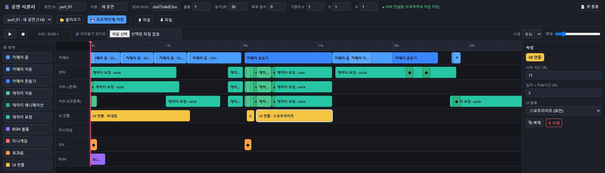
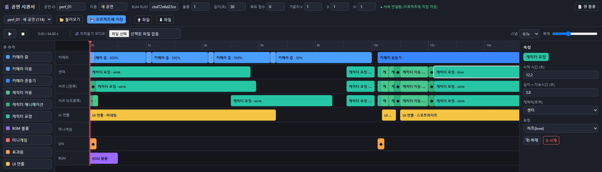

# 연출 제작과 다국어

[프로젝트](../README.md) / [전체 코드](CodeIndex.md)

## 타임라인 편집 도구

기획자가 시간 순서에 따라 복잡한 연출 데이터를 직접 편집할 수 있도록 웹 기반 [시퀀서](../SourceUpdates/abbb12c/tools/performance-sequencer/index.html)를 제작했습니다. 연출의 시점과 속성을 화면에서 편집하고 게임에서 사용하는 데이터로 연결해, 데이터를 직접 수정하는 작업을 줄였습니다. 실제 기획자와 팀원이 사용했습니다.

연동 규칙의 설계, 검토와 게임 통합을 담당했으며 웹 UI 코드 작성에는 AI 보조를 활용했습니다. 지원되는 연출 유형의 편집은 도구에서 처리하지만 새로운 연출 기능에는 런타임 구현이 필요합니다.

### 편집 결과가 게임 데이터로 이어지는 경로

`index.html`의 `gatherHeader`, `gatherCues`가 편집 내용을 구성하고 `saveToProject`가 로컬 서버의 `/api/save`에 전달합니다. [serve.cjs](../SourceUpdates/abbb12c/tools/performance-sequencer/serve.cjs)가 요청을 받고, [csv-store.cjs](../SourceUpdates/abbb12c/tools/performance-sequencer/csv-store.cjs)가 `PerformanceTable.csv`와 `PerformanceCueTable.csv`에서 같은 공연 ID의 행을 교체합니다. 불러왔을 때와 저장 직전의 공연 데이터가 다르면 저장을 중단해 다른 편집 내용을 덮어쓰지 않도록 했습니다. 이 경우 편집한 큐를 CSV로 내보낸 뒤 최신 공연을 다시 불러올 수 있습니다.

Node.js 22 이상에서 [start-sequencer.bat](../SourceUpdates/abbb12c/tools/performance-sequencer/start-sequencer.bat) 또는 `node serve.cjs`로 실행하고 `http://127.0.0.1:7788`을 엽니다. 게임 프로젝트에서는 로컬 CSV에 저장한 뒤 Maker의 Refresh로 반영합니다. 발췌본은 CSV 가져오기와 내보내기로 편집 화면을 확인할 수 있고, 프로젝트에 저장하려면 `RootDesk/MyDesk/Performance/Data`의 원본 CSV 두 개가 필요합니다.

두 CSV는 임시 파일에 쓴 뒤 순차적으로 교체합니다. 도중에 교체가 실패하면 먼저 교체한 파일을 백업에서 되돌리는 경로를 두었습니다.

[첫 데뷔 스테이지 공연 재생 영상 (30초)](../Media/performance-demo.mp4)

## 게임의 연출 실행과 결과

[PerformanceCueRow](../SourceUpdates/abbb12c/RootDesk/MyDesk/Performance/Data/PerformanceCueRow.mlua)와 [EPerformanceCueType](../Source/RootDesk/MyDesk/Performance/Data/EPerformanceCueType.mlua)에 연출 데이터와 유형을 정의하고, [PerformanceConductor](../SourceUpdates/abbb12c/RootDesk/MyDesk/Performance/PerformanceConductor.mlua)에서 실행하도록 연결했습니다.

`PerformanceConductor.OnUpdate`는 로컬 재생 시간과 다음 큐 인덱스를 기준으로 실행 시점이 된 큐를 `DispatchCue`에 넘깁니다. 연출 유형별 처리는 핸들러로 분기합니다. 편집 도구의 미리보기와 게임 엔티티, 카메라를 사용하는 실제 공연 재생은 구분됩니다.

| 역할 | 코드 |
| --- | --- |
| 연출 효과 | [PerformanceEffectLogic](../Source/RootDesk/MyDesk/Performance/PerformanceEffectLogic.mlua) |
| 결과 계산과 표시 연결 | [PerformanceResultManager](../Source/RootDesk/MyDesk/Performance/PerformanceResultManager.mlua), [PerformanceScoreUILogic](../Source/RootDesk/MyDesk/Performance/PerformanceScoreUILogic.mlua) |
| 결과 이후 화면과 이동 | [PerformancePostFlowLogic](../Source/RootDesk/MyDesk/Performance/PerformancePostFlowLogic.mlua), [PerformancePhotocardUILogic](../Source/RootDesk/MyDesk/Performance/PerformancePhotocardUILogic.mlua) |
| 반복 연출 컴포넌트 | [AudienceJumpComponent](../Source/RootDesk/MyDesk/Performance/AudienceJumpComponent.mlua), [LightStickSwayComponent](../Source/RootDesk/MyDesk/Performance/LightStickSwayComponent.mlua), [SpotlightSwayComponent](../Source/RootDesk/MyDesk/Performance/SpotlightSwayComponent.mlua) |

## 언어 표시와 화면 연동

현재 텍스트 조회는 [LocaleTextUtil](../Source/RootDesk/MyDesk/Utils/LocaleTextUtil.mlua)에서 플랫폼 `LocalizationService`에 연결합니다. [LocalizedFormatTextComponent](../Source/RootDesk/MyDesk/UI/LocalizedFormatTextComponent.mlua)는 실행 중 값을 텍스트 인자에 적용하고, [LocalizedNameTagComponent](../Source/RootDesk/MyDesk/Localization/LocalizedNameTagComponent.mlua)는 캐릭터 이름표를 갱신합니다.

초기 다국어 연동 이후 공동 수정된 구조를 수록했습니다. 대화 표시와 서식 처리는 [Dialog](../Source/RootDesk/MyDesk/Dialog/)와 [TemplateTextFormatter](../Source/RootDesk/MyDesk/Utils/TemplateTextFormatter.mlua)에서 확인할 수 있습니다.
